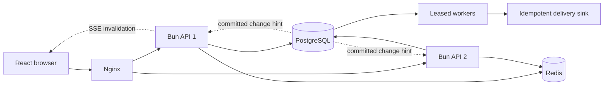

# Architecture and decisions

Rush is a modular application with independent API and worker processes. The deployable demo has two API replicas behind an Nginx least-connections upstream. The UI is React; shared modules contain browser-safe contracts. Hono route modules compose transport behavior, while domain operations own transactions.



## Authority and consistency

| State                                               | Authority           | Consistency                                                            |
| --------------------------------------------------- | ------------------- | ---------------------------------------------------------------------- |
| Seat ownership, orders, payment-event deduplication | PostgreSQL          | Transactional writes and database constraints                          |
| Admission capacity                                  | PostgreSQL          | Event-scoped advisory lock serializes lease grants                     |
| Waiting-room arrival order and liveness             | Redis               | Atomic sequence and heartbeat scripts; ordering resets after data loss |
| Rate-limit tokens                                   | Redis               | Atomic per-session refill and consume                                  |
| Undelivered events and their claim ownership        | PostgreSQL          | Durable outbox, expiring leases, fenced acknowledgements               |
| Browser views                                       | Authorized snapshot | Can be stale; refreshed after hints and periodically                   |
| Metrics and trace samples                           | API process         | Bounded, ephemeral; aggregate through an external metrics collector    |

Inventory invariant: every held or sold seat has exactly one matching active order; every seat in an active order points back to that order. Reservation groups commit entirely or fail entirely. Prices are server-selected integer rupees for this one-currency demo. The read snapshot uses repeatable-read isolation to avoid reconciling unrelated moments.

## ADR 001: Keep a modular application

**Decision:** Separate transport, domain operations, stores, worker effects, telemetry, and browser concerns without introducing network services for each domain object.

**Reason:** The demonstrable problem is contention and recovery. Multiple API replicas and worker processes exercise those boundaries without unnecessary distributed ownership. A future service split needs an independent scaling or team-ownership reason.

## ADR 002: Redis orders; PostgreSQL admits

**Decision:** Redis assigns monotonically increasing FIFO scores using a server-owned sequence. Heartbeats expire inactive queue entries after 30 seconds. Cleanup and promotion scans are bounded; every promoted candidate is independently checked for a fresh heartbeat, and the waiting set is capped at 10,000 entries. The database serializes the grant decision and caps valid admissions at 25.

A caller can promote the next eligible waiting sessions, so progress does not depend on a specific head waiter making the grant request. Active admissions are reconciled out of the Redis waiting set before new grants. A crash after database commit leaves a repairable Redis entry, not extra admission capacity.

**Tradeoff:** The short admission transaction includes bounded Redis reads while holding a capacity lock. That prioritizes a simple durable limit over maximal admission throughput. Redis outage pauses new grants. Redis loss can reorder waiting users but cannot increase the durable capacity cap. Use a dedicated admission service or durable queue before claiming global fairness at larger scale.

## ADR 003: Durable idempotency before new-work gates

**Decision:** Uniqueness on `(session_id, idempotency_key)` and an advisory lock serialize equal requests. Sorted seat IDs form the canonical selection comparison. A completed request is looked up before admission and rate-limit checks; changed selections return 409.

**Contract:** Replays return the current resource, not a byte-for-byte historical HTTP response. A replay can therefore return an expired or confirmed order. The key remains associated with the order for its lifetime. No archival policy is implemented.

## ADR 004: At-least-once delivery with ownership fencing

```mermaid
sequenceDiagram
  participant API
  participant DB as PostgreSQL
  participant Worker
  participant Provider as Idempotent sink
  API->>DB: Commit order transition + outbox event
  Worker->>DB: Claim ready rows; assign token + 30s lease
  DB-->>Worker: Commit short claim transaction
  Worker->>Provider: Deliver with event ID as idempotency key
  Provider-->>Worker: Success
  Worker->>DB: Acknowledge only WHERE claim_token matches
```

**Decision:** Claim at most 10 jobs with `FOR UPDATE SKIP LOCKED`, commit the claim, deliver concurrently outside that transaction, then acknowledge with the claim token. The sandbox sink commits its receipt separately and deduplicates by event ID. An HTTP sink uses a three-second deadline and an idempotency header.

A crash before sink commit leaves no local effect. A crash after sink commit but before acknowledgement causes redelivery after lease expiry; the same event ID prevents another local effect. A newer worker can reclaim an expired lease; an obsolete worker cannot acknowledge or reschedule its replacement's claim.

**Tradeoff:** This is at-least-once delivery. A remote provider must implement idempotency. Full-jitter retries stop after five claims; exhausted work requires an audited operator replay. An expired final claim becomes a dead letter. There is no exactly-once network guarantee.

## ADR 005: Compensate for late payment

**Decision:** Reservation expiry is durable in PostgreSQL and checked during payment transitions as well as by a sweep. If the seat is already released, successful payment queues a refund and never reclaims inventory. Duplicate and distinct success event IDs cannot emit a second confirmation for an already confirmed order.

**Tradeoff:** Payment and refund providers are sandboxed. A live payment integration needs provider event typing, amount/currency validation, refund status callbacks, reconciliation, and credentials. These are explicitly outside the current implementation.

## ADR 006: Notifications are hints

**Decision:** An audit insert triggers transactional `NOTIFY`; each API maintains one database listener and coalesces browser invalidations. Clients fetch authorized snapshots on reconnect and every 15 seconds. Live connections are capped at 200 per API and cleaned up on disconnect.

**Tradeoff:** Notifications can be missed. SSE revisions are diagnostic identifiers, not durable replay offsets. A missed hint delays freshness, not purchase correctness. Redis Pub/Sub is not used as a durable event log.

## ADR 007: Bound failure amplification

The application limits reservation, payment, and read concurrency independently. Redis calls have 600 ms deadlines; three failures open a per-process circuit for five seconds, with one recovery probe. Database connections have a three-second connection deadline, 1.5-second lock deadline, five-second statement deadline, and ten-second idle-transaction deadline. External delivery times out before its 30-second lease expires.

These defaults are starting points measured by the local fixture, not universal production settings. The shared database pool remains a dependency across lanes. A real deployment should tune limits from offered traffic and latency distributions and add ingress abuse control.

## ADR 008: One frontend toolchain

Vite+ 1.2 owns development/build commands, Oxfmt, Oxlint, and type-aware checks. The root configuration defines the policy. Bun remains the application and test runtime because integration fixtures deliberately spawn and terminate Bun processes. No second formatter, linter, or unit-test runtime is required.

## ADR 009 — Validate data at the browser boundary

**Decision:** Shared Zod schemas define response shapes and infer TypeScript types. The HTTP adapter parses every successful response before React sees it. Persisted sandbox snapshots are validated before use. SQL order/seat projections carry domain status unions, and singleton results are checked at runtime. Checked indexed access and exact optional properties supplement TypeScript strict mode.

**Tradeoff:** Runtime validation adds bundle size and parse work. Unknown fields are accepted and stripped to allow additive server deployments, while missing required data or illegal domain values fail with a controlled error. These schemas describe transport validity; inventory consistency remains enforced by transactions and reconciliation.

**Evidence:** HTTP-boundary tests cover malformed JSON, invalid success payloads, missing credentials, request-key preservation, rejection status, and deadlines. The real-service test parses public and operator snapshots, reservations, payments, telemetry, and outbox jobs through the same browser adapter.
